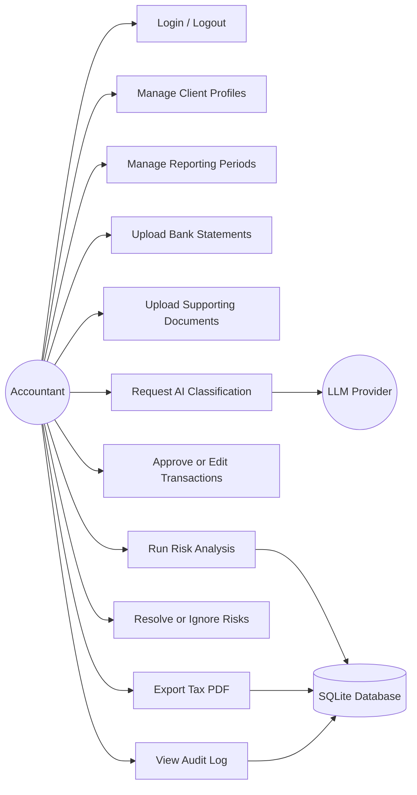
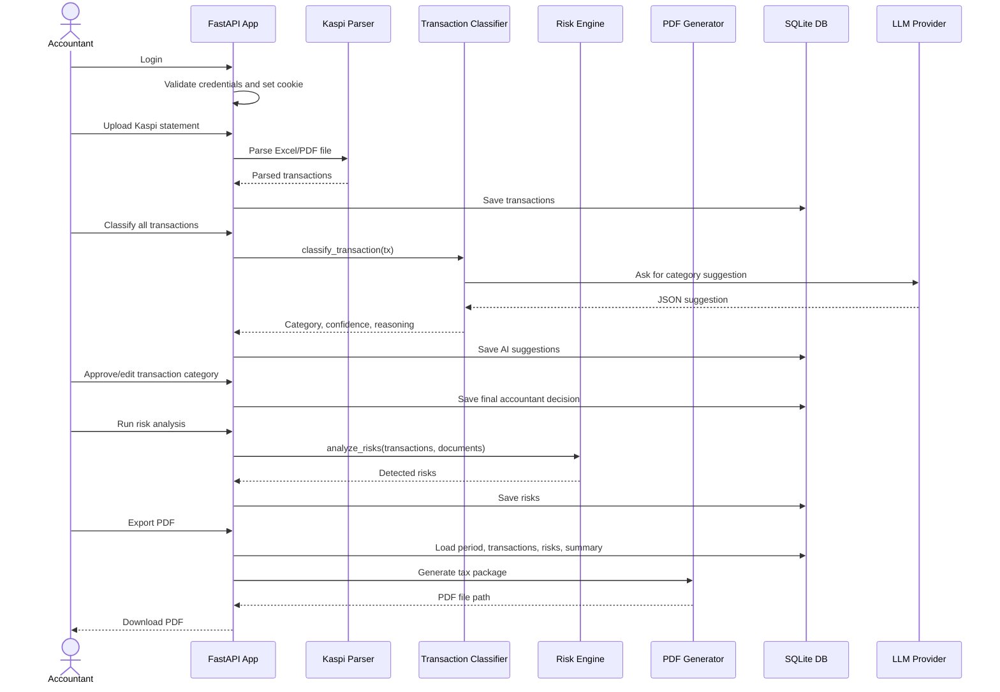
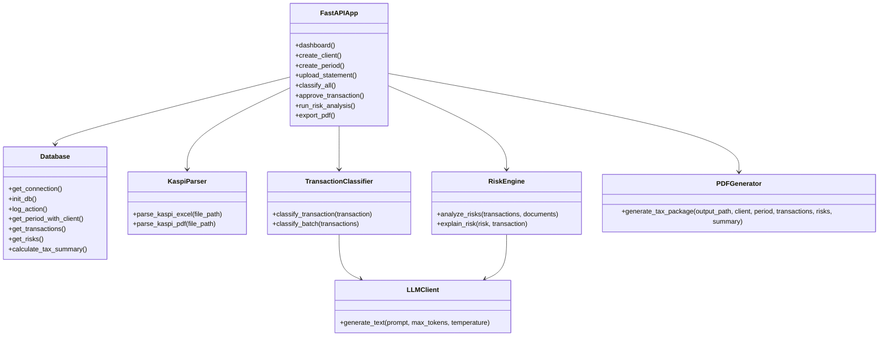
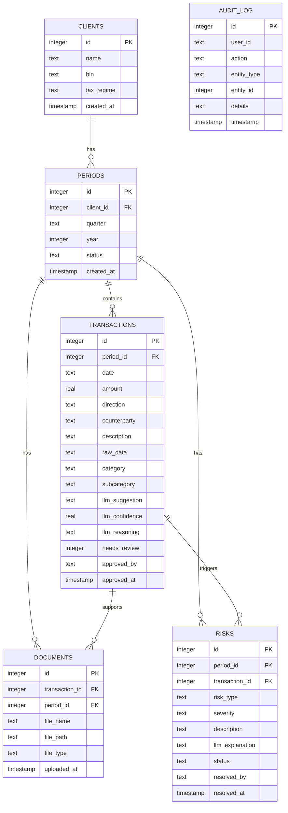

# AI Copilot for Accountants - MVP Report

## Project Overview

**AI Copilot for Accountants** is an MVP web application for accountants working with individual entrepreneurs in Kazakhstan. The system helps import Kaspi bank statements, classify transactions with an LLM suggestion, calculate USN tax, detect tax risks, attach supporting documents, export a PDF tax package, and keep an audit trail.

The product follows a **human-in-the-loop** approach: AI can suggest and explain, but the accountant reviews and confirms decisions.

## MVP Functionalities - 10 Points

The MVP includes more than three required functional areas: authentication, profile/client management, and the main accounting workflow.

### 1. Authentication

- Login page with email and password.
- Protected dashboard, period pages, and audit log.
- Cookie-based authenticated session.
- Logout action that clears the authentication cookie.

Implemented routes:

- `GET /login`
- `POST /login`
- `GET /logout`

### 2. User Profile / Client Profile Management

The authenticated accountant can manage client profiles for individual entrepreneurs.

- Create client profile with name, BIN/IIN, and tax regime.
- View all client profiles on the dashboard.
- Connect each reporting period to a selected client profile.

Implemented route:

- `POST /clients/create`

### 3. Reporting Period Management

- Create tax reporting periods by client, quarter, and year.
- View all periods on the dashboard.
- Open a detailed workspace for a selected period.

Implemented routes:

- `POST /periods/create`
- `GET /period/{period_id}`

### 4. Bank Statement and Document Upload

- Upload Kaspi Business statements in `.xlsx`, `.xls`, or `.pdf` format.
- Parse transactions from statement files.
- Upload supporting documents such as invoices, acts, contracts, PDFs, images, and spreadsheets.
- Store uploaded file metadata in the database.

Implemented routes:

- `POST /period/{period_id}/upload-statement`
- `POST /period/{period_id}/upload-document`

### 5. AI Transaction Classification

- Classify imported transactions using the configured LLM provider.
- Save AI category suggestion, confidence, and reasoning.
- Mark low-confidence results as needing accountant review.
- Keep final approval manual.

Implemented route:

- `POST /period/{period_id}/classify-all`

### 6. Accountant Review and Approval

- Accountant can approve or edit each transaction category.
- Supported categories: `income`, `expense`, and `personal`.
- System records who approved the transaction and when.
- Approved transactions are used in tax summary calculation.

Implemented routes:

- `GET /api/transaction/{tx_id}`
- `POST /transaction/{tx_id}/approve`

### 7. Tax Risk Analysis

- Deterministic rule engine detects risks without relying on LLM decisions.
- Example risks include large cash withdrawals, missing documents, unclassified transactions, round amounts, and unknown counterparties.
- Accountant can mark risks as resolved or ignored.
- LLM can explain detected risks in plain language.

Implemented routes:

- `POST /period/{period_id}/analyze-risks`
- `GET /risk/{risk_id}/explain`
- `POST /risk/{risk_id}/resolve`

### 8. Tax Summary and PDF Export

- Calculates income, expenses, personal transactions, unclassified transactions, and USN tax.
- Generates a PDF tax package with summary, transactions, and risk list.

Implemented route:

- `GET /period/{period_id}/export-pdf`

### 9. Audit Log

- Logs important actions such as client creation, period creation, statement upload, classification, transaction approval, risk analysis, risk resolution, and PDF export.
- Displays latest audit events for accountant review.

Implemented route:

- `GET /period/{period_id}/audit`

## Architecture - 4 Points

### Use Case Diagram

### Sequence Diagram

Main flow: accountant uploads a bank statement, classifies transactions, approves them, analyzes risks, and exports a PDF.

### Class Diagram

### ER Diagram

## Used Technologies - 2 Points

### Backend

- **Python 3.11+** - main programming language.
- **FastAPI** - web framework and route handling.
- **Uvicorn** - ASGI development server.
- **Jinja2** - HTML template rendering.
- **SQLite** - local relational database.
- **python-dotenv** - environment variable loading.

### Data Processing

- **openpyxl** - parsing Kaspi Excel statements.
- **pdfplumber** - parsing PDF bank statements.
- **ReportLab** - generating PDF tax packages.

### AI / LLM

- **Gemini API** or **Anthropic API** - LLM-based transaction classification and risk explanation.
- Local fallback logic when an LLM provider is unavailable or returns invalid data.

### Frontend

- **HTML templates** - dashboard, period workspace, login, audit pages.
- **CSS** - custom styling in `static/css/main.css`.
- **JavaScript Fetch API** - async form submission, uploads, classification, approval, and risk actions.

### Storage

- **SQLite tables**: `clients`, `periods`, `transactions`, `documents`, `risks`, and `audit_log`.
- **Local filesystem**: uploaded statements/documents in `data/uploads` and generated PDFs in `data/exports`.

## Scoring Summary

| Criteria | Evidence | Points |
|---|---|---:|
| MVP functionalities | Authentication, client/user profile management, periods, uploads, AI classification, review, risk analysis, PDF export, audit log | 10 |
| Architecture | Use-case, sequence, class, and ER diagrams | 4 |
| Used technologies | Backend, frontend, database, AI, data processing, PDF generation | 2 |
| **Total** |  | **16** |
